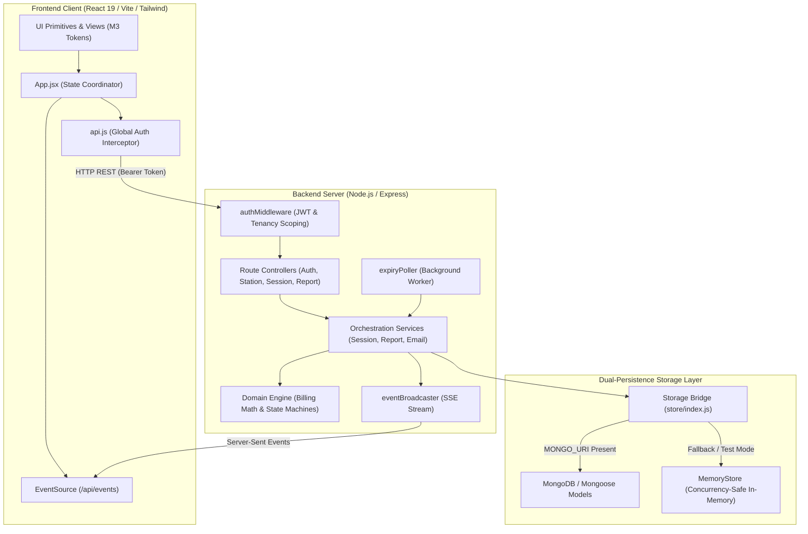
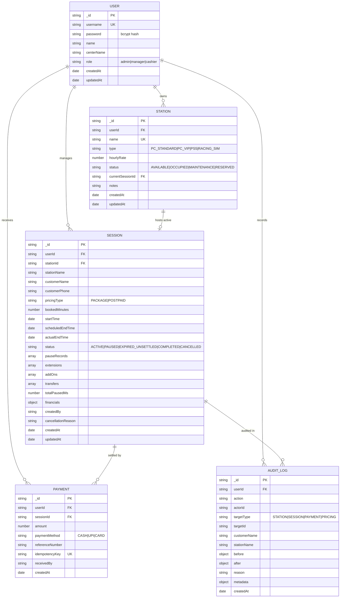
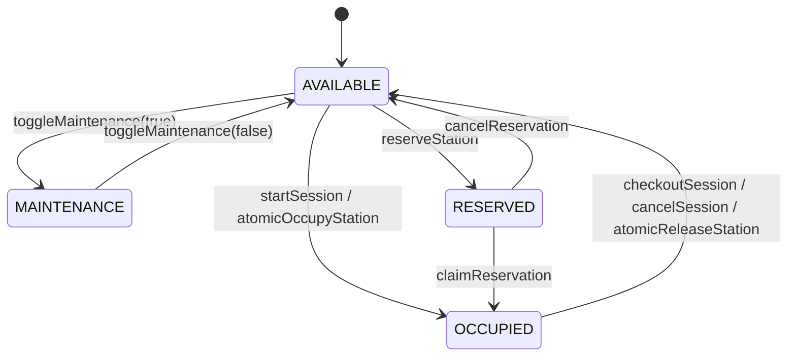
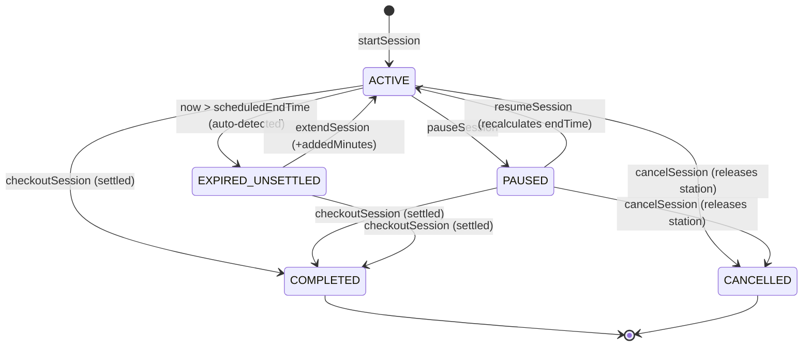
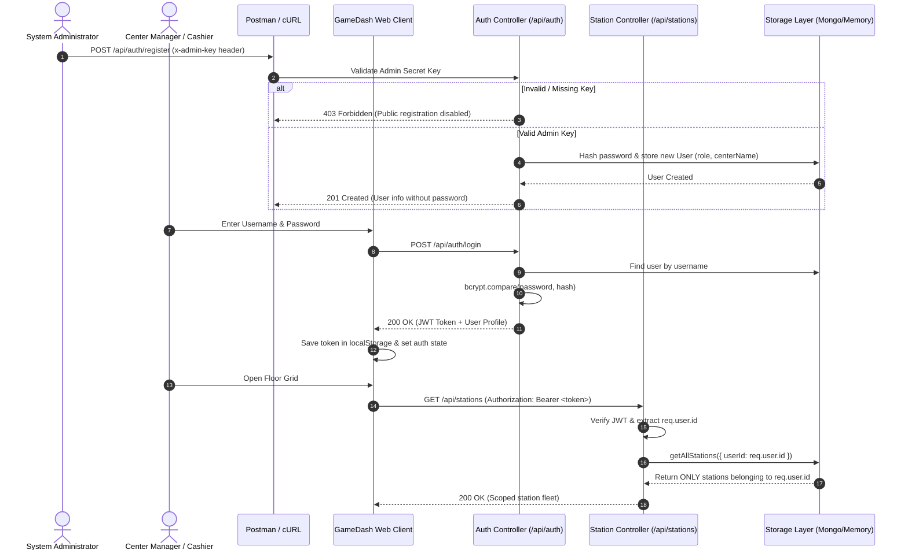

# GameDash — Technical Architecture & System Design Blueprint

This document details the architectural design, component responsibilities, data models, state machines, communication protocols, and execution workflows of the **GameDash** Gaming Center Management System.

---

## 1. Architectural Philosophy & Core Principles

GameDash is engineered around five fundamental architectural tenets:

1. **Package Independence:** The client and server are physically separate packages (`client/` and `server/`), each possessing its own `package.json`, isolated dependencies, and dedicated build/runtime lifecycles. The root directory serves solely as an orchestration layer.
2. **Server-Authoritative Time & Determinism:** Client clocks are inherently untrusted. All session timers, elapsed minutes, pause tracking, grace periods, and overtime calculations are computed strictly using server UTC timestamps (`Date.now()`).
3. **State Separation:** Physical hardware availability is decoupled from player session lifecycle. A station remains `OCCUPIED` even after a session expires until the cashier settles payment or explicitly releases the station.
4. **Dual-Persistence Engine:** The system functions seamlessly in two operational modes without code modifications:
   - **Production Mode:** MongoDB via Mongoose schemas with indexed multi-tenant keys.
   - **Zero-Dependency / Offline / Test Mode:** High-performance in-memory store (`memoryStore.js`) supporting atomic operations, Map indexes, and simulated unique constraints.
5. **Strict Multi-Tenancy:** Center data (stations, sessions, receipts, customer records, audit logs) is scoped to the authenticated operator (`userId`). No center can inspect or modify another center's operations.

---

## 2. High-Level System Architecture

The following diagram illustrates the interaction between client layers, backend services, persistence, and external workers:



---

## 3. Component Responsibilities

### 3.1 Frontend (`client/src/`)

- **`App.jsx`:** The root interactive coordinator. Manages active views (`floor`, `sessions`, `customers`, `reports`, `audit`, `inventory`), auth session state, global toast messages, modal visibility, and connects to the Server-Sent Events stream.
- **`utils/api.js`:** Global API client that patches `window.fetch` to automatically inject `Authorization: Bearer <token>` into internal `/api/` calls, intercepts `401 Unauthorized` responses to trigger clean logout, and persists user state in `localStorage`.
- **`components/LoginView.jsx`:** Material Design 3 dark theme sign-in interface. Exposes username/password fields and displays the administrative policy notice explaining that operator accounts are provisioned via Postman.
- **`components/AppHeader.jsx`:** Persistent top bar featuring a live digital wall clock, real-time SSE connection indicator, urgent alerts badge, quick-start session launcher, station creation button, and cashier profile logout.
- **`components/Sidebar.jsx`:** Responsive navigation layout supporting a full drawer on desktop, navigation rail on tablet, and bottom tab bar on mobile. Displays active session counts and on-duty operator info.
- **`components/StationCard.jsx`:** Interactive station card displaying dynamic hardware states (Available, Occupied, Paused, Warning, Expired, Maintenance), live progress bar, remaining time, quick extensions, station transfers, checkouts, and safe deletion.
- **`components/ActiveSessionsView.jsx`:** Dense operational table of live gaming sessions with remaining minutes, overtime warnings, and direct control triggers.
- **`components/CustomerHistoryModal.jsx`:** Customer ledger providing search, date/month filtering, customer session logs, and 30-day usage analytics.
- **`components/ShiftReportModal.jsx`:** Financial shift reconciliation screen computing total revenue, Cash vs UPI breakdown, station utilization, and gaming hours sold vs consumed.
- **`components/AuditTrailModal.jsx`:** Chronological security audit log displaying staff actions with timestamp, actor ID, and stated reasons.
- **`components/StationInventoryView.jsx`:** Fleet management view for managing PC hardware specifications, hourly rates, and maintenance locks.
- **`components/FiveMinuteWarningModal.jsx`:** Real-time priority popup triggered when a player enters the 5-minute countdown window.
- **`components/ui/`:** Pure Material Design 3 UI primitives (`Button`, `Card`, `Input`, `Select`, `TextField`, `Modal`, `Snackbar`, `Badge`, `Chip`, `FAB`, `Switch`, `Checkbox`, `Tabs`).

### 3.2 Backend (`server/src/`)

- **`app.js`:** Express application factory. Configures CORS, JSON body parsers, public auth endpoints, authenticated feature routes, SSE stream routes, static production bundle serving, and centralized error handling.
- **`server.js`:** Application entrypoint. Establishes the database connection, boots the background expiration worker, and starts the HTTP listener on port `4000`.
- **`middleware/authMiddleware.js`:** JWT Bearer token validator. Extracts token payload (`id`, `username`, `role`), sets `req.user`, and provides `isTestEnv()` backward compatibility for automated tests.
- **`controllers/authController.js`:** Handles admin-gated user registration (`POST /api/auth/register`), password comparison and JWT issuance (`POST /api/auth/login`), and session verification (`GET /api/auth/me`).
- **`controllers/stationController.js`:** Handles fleet listing, station creation, maintenance mode toggling, and safe station deletion.
- **`controllers/sessionController.js`:** Handles session lifecycle transitions (start, pause, resume, extend, transfer, checkout, cancel), live overview retrieval, and customer history ledger queries.
- **`controllers/reportController.js`:** Generates comprehensive daily shift reconciliation and financial metrics.
- **`domain/billingCalculator.js`:** Pure, deterministic financial mathematics. Calculates elapsed minutes, applies 5-minute grace period rules, calculates 15-minute block overtime surcharges, and aggregates multi-part payments.
- **`domain/sessionStateMachine.js`:** Enforces valid session state transitions and derives dynamic states (`EXPIRED_UNSETTLED`) based on current timestamps.
- **`domain/stationStateMachine.js`:** Enforces valid station state transitions and validates bookability.
- **`services/sessionService.js`:** Core session lifecycle orchestrator. Implements atomic station occupancy, pause record accumulation, scheduled end-time recalculation, and payment generation.
- **`services/expiryPoller.js`:** Periodic background worker running every 5 seconds to identify expired sessions, broadcast 5-minute warnings, send automated owner email alerts, and execute hourly 30-day session pruning.
- **`services/eventBroadcaster.js`:** SSE connection manager managing active cashier clients and broadcasting real-time lifecycle events.
- **`services/reportService.js`:** Generates shift reports scoped strictly to the calling tenant.
- **`services/emailService.js`:** Nodemailer email transport delivering owner alerts with fallback mock logging.
- **`storage/index.js` & `storage/memoryStore.js`:** The persistence layer. Routes calls between MongoDB (via Mongoose) and the concurrency-safe in-memory store.

---

## 4. Data Models & Entity-Relationship Diagram

All root models include `userId` to enforce multi-tenant isolation.



---

## 5. State Machines & Lifecycle Transitions

### 5.1 Station State Machine



### 5.2 Session State Machine



---

## 6. Deterministic Billing Math & Overtime Engine

All duration and billing calculations are performed in `server/src/domain/billingCalculator.js`:

### 6.1 Elapsed Duration
$$\text{Elapsed Minutes } (T_{\text{elapsed}}) = \left\lfloor \frac{(\text{Current Time} - \text{Start Time}) - \text{Total Paused Ms}}{60000} \right\rfloor$$

### 6.2 Scheduled Duration
$$\text{Scheduled Minutes } (D_{\text{sched}}) = \text{Initial Booked Minutes} + \sum \text{Extended Minutes}$$

### 6.3 Overtime Calculation & Grace Period Rules
$$\text{Raw Overtime Minutes } (D_{\text{over}}) = \max(0, T_{\text{elapsed}} - D_{\text{sched}})$$

- **Grace Period ($G$):** $5 \text{ minutes}$
- **Billing Block Size ($B$):** $15 \text{ minutes}$
- **Tier Hourly Rate ($R_{\text{ot}}$):** Station's configured hourly rate

$$\text{Billable Overtime Minutes } (D_{\text{billable}}) = \begin{cases} 
0, & \text{if } D_{\text{over}} \le G \\
\left\lceil \frac{D_{\text{over}}}{B} \right\rceil \times B, & \text{if } D_{\text{over}} > G 
\end{cases}$$

$$\text{Overtime Fee } (F_{\text{over}}) = D_{\text{billable}} \times \left( \frac{R_{\text{ot}}}{60} \right)$$

### 6.4 Total Settlement
$$\text{Total Payable} = F_{\text{base}} + F_{\text{over}} + \sum \text{Add-ons} - \text{Discounts}$$
$$\text{Balance Due} = \text{Total Payable} - \sum \text{Payments Received}$$

---

## 7. Authentication & Multi-Tenant Data Isolation Flow



---

## 8. Real-Time Communication & Background Workers

### 8.1 Server-Sent Events (SSE) Protocol
- **Endpoint:** `GET /api/events`
- **Headers:** `Content-Type: text/event-stream`, `Cache-Control: no-cache`, `Connection: keep-alive`
- **Reconnection Logic:** Clients automatically attempt reconnection after 3 seconds upon network disruption.
- **Dispatched Event Types:**
  - `SESSION_STARTED`: Broadcast upon session initiation.
  - `SESSION_PAUSED`: Broadcast when a session is paused with pause start timestamp.
  - `SESSION_RESUMED`: Broadcast when resumed with recalculated scheduled end time.
  - `SESSION_EXTENDED`: Broadcast when minutes are added.
  - `SESSION_TRANSFERRED`: Broadcast when a player is moved to another PC.
  - `SESSION_COMPLETED`: Broadcast upon checkout and settlement.
  - `SESSION_CANCELLED`: Broadcast when a session is aborted.
  - `SESSION_EXPIRY_WARNING`: Broadcast when a player has $\le 5$ minutes remaining.
  - `SESSION_EXPIRED`: Broadcast when a session transitions past scheduled end time into overtime.

### 8.2 Expiry Poller Worker
The `expiryPoller` runs on a 5000ms timer in `server/src/services/expiryPoller.js`:
1. Scans active sessions (`status === 'ACTIVE'`).
2. If `now > scheduledEndTime`: Transitions session to `EXPIRED_UNSETTLED`, broadcasts `SESSION_EXPIRED`, and cleans up active warning tracking.
3. If $0 < (\text{scheduledEndTime} - \text{now}) \le 300,000 \text{ ms}$ (5 minutes): Dispatches `SESSION_EXPIRY_WARNING` (deduplicated per session) and invokes `emailService.sendExpiryAlert()`.
4. Once per hour: Executes `store.pruneOldSessions()`, automatically deleting completed or cancelled session records older than 30 days.

---

## 9. Concurrency & Data Integrity Guardrails

1. **Atomic Station Occupancy:**
   To prevent two cashiers from assigning the same station simultaneously:
   - When using MongoDB: `Station.findOneAndUpdate({ _id: stationId, status: 'AVAILABLE', currentSessionId: null }, { status: 'OCCUPIED', currentSessionId: sessionId })`.
   - When using MemoryStore: A synchronous Map read-and-update check inside the single-threaded event loop.
   - If atomic occupancy fails, the newly created session is rolled back to `CANCELLED` and `409 Conflict` is returned.
2. **Safe Station Deletion Guard:**
   `DELETE /api/stations/:id` executes multi-level safety validation:
   - Rejects deletion if station status is `OCCUPIED` or has `currentSessionId`.
   - Queries sessions for the station and rejects deletion if any session is in `ACTIVE`, `PAUSED`, or `EXPIRED_UNSETTLED` state.
   - On successful deletion, logs an immutable record in `AuditLog`.
3. **Payment Idempotency:**
   Payments accept an `idempotencyKey`. Duplicate submissions (e.g. repeated button clicks or network retries) return the existing transaction record rather than double-charging.

---

## 10. Verification & Test Architecture

The system maintains 100% test coverage across 59 automated test suites executed via the native Node.js test runner:

```bash
npm test
```

### Test Suite Organization:
- **`src/tests/auth.test.js` (12 tests):** Public registration blocking (403), admin key verification, duplicate username conflict (409), password hashing, JWT authentication, and strict multi-tenant isolation between User Alpha and User Beta across stations, sessions, live overview, and shift reports.
- **`src/tests/billingCalculator.test.js` (14 tests):** Pro-rata rounding, pause deduction, initial and extended end time, grace period thresholds ($0 \text{ fee} \le 5\text{m}$), and 15-minute block increments.
- **`src/tests/sessionApi.test.js` (15 tests):** REST lifecycle, atomic occupancy locking, concurrency collision rollbacks, pause/resume calculations, station transfers, idempotent checkouts, session cancellations, and audit queries.
- **`src/tests/stateMachine.test.js` (12 tests):** Valid and illegal transition enforcement for Station and Session state machines.
- **`src/tests/expiryPoller.test.js` (3 tests):** Expiry detection, 5-minute remaining warning events, and event broadcasting.
- **`src/tests/report.test.js` (3 tests):** Daily revenue aggregation, Cash vs UPI breakdown, chronological audit trail, and 30-day session retention pruning.
